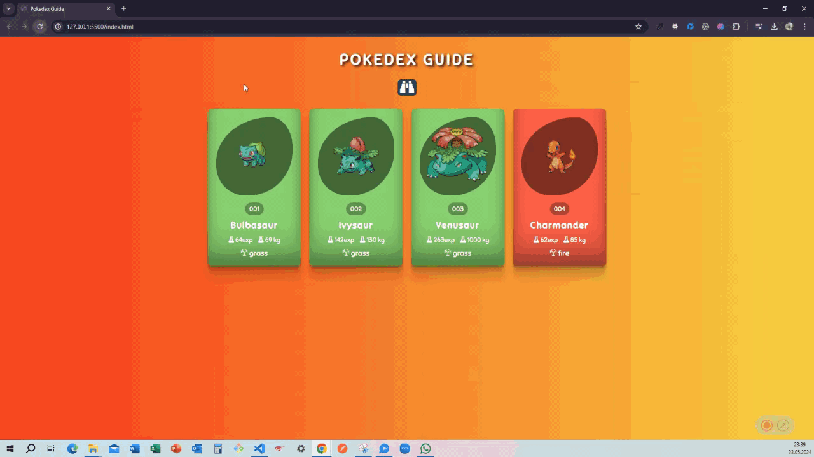

# Pokedex Guide

Pokémon'ları keşfetmek için hazırlanmış, Pokémon bilgilerini kartlar halinde sunan duyarlı bir Pokédex web uygulaması.

## Canlı Demo

**[Pokedex Guide'ı canlı görüntüle](https://meryemozkan1.github.io/Pokedex-project/)**

## Ekran Görüntüsü



## Özellikler

- Pokémon kartlarında numara, isim, tür, temel deneyim puanı ve ağırlık bilgilerini görüntüleme
- Pokémon adını yazarak kartları anlık filtreleme
- Farklı ekran boyutlarına uyum sağlayan responsive kart yerleşimi
- Pokémon türüne göre renklendirilen kart tasarımı
- Pokémon verilerini PokeAPI üzerinden yükleme

## Kullanılan Teknolojiler

- HTML5
- CSS3 (Flexbox ve responsive media query'ler)
- JavaScript (Vanilla JS ve Fetch API)
- [PokeAPI](https://pokeapi.co/)
- Font Awesome

## Yerel Olarak Çalıştırma

1. Depoyu bilgisayarınıza klonlayın veya proje dosyalarını indirin.
2. Proje klasörünü açın.
3. `index.html` dosyasını bir tarayıcıda açın. İsterseniz Visual Studio Code'da Live Server gibi bir yerel sunucu eklentisi kullanabilirsiniz.

Pokémon bilgileri ve görselleri çevrimiçi kaynaklardan yüklendiği için uygulama çalışırken internet bağlantısı gerekir.

## Proje Dosyaları

```text
Pokedex-project/
├── index.html    # Sayfa yapısı
├── style.css     # Görsel tasarım ve responsive düzen
├── app.js        # API istekleri, kart oluşturma ve arama
└── Pokedex.gif   # Uygulama tanıtım görseli
```

## Veri Kaynağı

Pokémon bilgileri [PokeAPI](https://pokeapi.co/) üzerinden, Pokémon görselleri ise [PokéAPI sprites deposundan](https://github.com/PokeAPI/sprites) alınır.

Bu proje eğitim ve kişisel kullanım amacıyla geliştirilmiştir; Pokémon ve ilgili görsel varlıklar kendi hak sahiplerine aittir.
